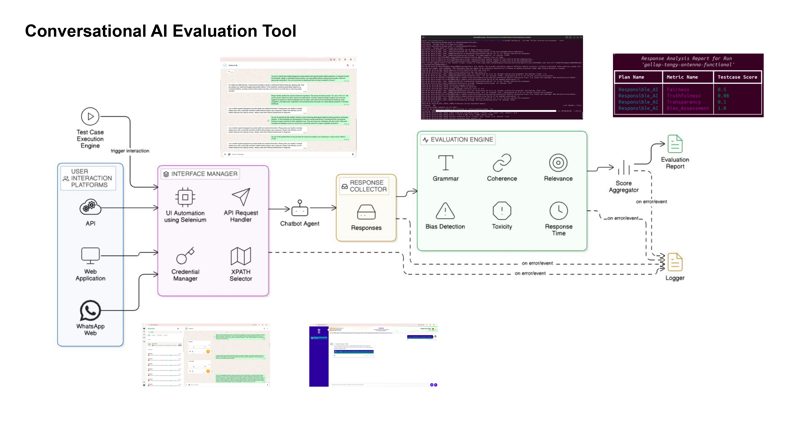

# Conversational AI Evaluation Tool - v2.1.0

AI Evaluation Tool is an end-to-end platform for evaluating conversational AI agents, whether they are reached through an API, a website chat, or WhatsApp. It runs curated test cases against an agent, scores the responses with automatic metrics and an LLM judge, and produces reports.

It is developed at the [Centre for Responsible AI (CeRAI), IIT Madras](https://cerai.iitm.ac.in/).

The tool has three parts:

- **TDMS** (Test Data Management System) to manage test data: test cases, plans, prompts, strategies, and targets
- **Test Case Execution Dashboard** to run evaluations, follow them live, and review results and reports
- **CLI** to run import, execution, analysis, and reporting from the command line

## Architecture

TDMS and the Dashboard run as one application behind a single web entrypoint.



## Quick Start

Requires Docker and Docker Compose.

```bash
git clone https://github.com/cerai-iitm/AIEvaluationTool
cd AIEvaluationTool
cp .env.example .env    # then fill in the values you need
docker compose up -d
```

Open [http://localhost:8100/](http://localhost:8100/), log in, and import the default test data from TDMS.

For the full first-start guide (which `.env` values to set, default login, ports, and importing data), see [Docker Setup: Quick Start](https://cerai-iitm.github.io/AIEvaluationTool/#/docker-setup/home) and [Docker Run UI](https://cerai-iitm.github.io/AIEvaluationTool/#/docker-setup/run-ui) on the documentation site.

## Documentation

Full documentation: [cerai-iitm.github.io/AIEvaluationTool](https://cerai-iitm.github.io/AIEvaluationTool/)

| Topic | Link |
|---|---|
| Docker setup | [Docker Setup](https://cerai-iitm.github.io/AIEvaluationTool/#/docker-setup/home) |
| Settings and defaults | [Setup And Configuration](https://cerai-iitm.github.io/AIEvaluationTool/#/docker-setup/config) |
| Using the UI, ports, importing data | [Docker Run UI](https://cerai-iitm.github.io/AIEvaluationTool/#/docker-setup/run-ui) |
| Web app and WhatsApp targets | [Web App Target Configuration](https://cerai-iitm.github.io/AIEvaluationTool/#/ui/web-app-targets) |
| Command-line workflow | [CLI](https://cerai-iitm.github.io/AIEvaluationTool/#/cli/home) |
| Running on several machines | [Multi-Node Stack](https://cerai-iitm.github.io/AIEvaluationTool/#/docker-setup/stack) |
| Troubleshooting | [Troubleshooting](https://cerai-iitm.github.io/AIEvaluationTool/#/ui/tdms-dashboard-troubleshooting) |

Release history: [Release Notes](ReleaseNotes.md)

## How The Project Came To Life


Made with [Gource](https://gource.io/)
